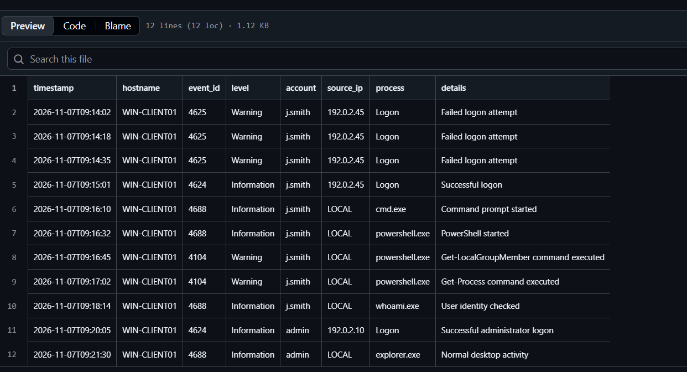
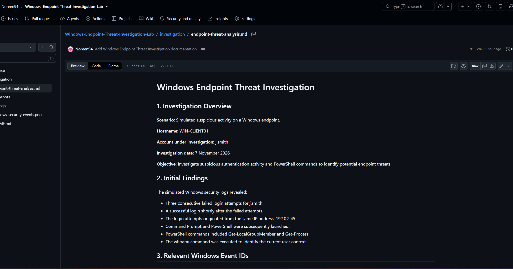

# Windows Endpoint Threat Investigation Lab

A hands-on SOC Level 1 investigation lab analysing simulated Windows security events, suspicious authentication activity, PowerShell commands and potential endpoint threats.

## Project Overview

This project simulates a Windows endpoint security investigation involving suspicious login activity followed by command-line and PowerShell execution.

The objective is to review Windows security event logs, identify potentially suspicious behaviour, assess the risk and document findings and recommended response actions.

## Investigation Scenario

A fictional user account, `j.smith`, experiences repeated failed login attempts followed by a successful login. Shortly afterwards, Command Prompt and PowerShell activity are recorded on the endpoint.

The activity is investigated to determine whether it could indicate unauthorised access or potentially malicious behaviour.

## Tools and Technologies

- Windows Security Event Logs (simulated)
- Event ID analysis
- PowerShell activity analysis
- CSV log analysis
- GitHub documentation

## Key Findings

- Three consecutive failed login attempts were recorded for `j.smith`.
- A successful login occurred shortly afterwards.
- Command Prompt and PowerShell were subsequently launched.
- PowerShell commands included `Get-LocalGroupMember` and `Get-Process`.
- The `whoami` command was executed to identify the current user context.

These events warrant further investigation. The available simulated logs do not confirm that the activity was malicious.

## Windows Event IDs Analysed

| Event ID | Description |
|---|---|
| 4625 | Failed logon attempt |
| 4624 | Successful logon |
| 4688 | Process creation |
| 4104 | PowerShell script block logging |

## Investigation Evidence

- [View Simulated Windows Security Logs](evidence/windows-security-events.csv)
- [View Endpoint Threat Investigation Report](investigation/endpoint-threat-analysis.md)

## Screenshots

### Simulated Windows Security Event Logs

### Endpoint Threat Investigation Report

  

## Recommended SOC Response

- Preserve the available security logs.
- Review the user's login activity and verify whether the successful login was authorised.
- Investigate the PowerShell commands and associated process activity.
- Review endpoint security alerts for additional evidence.
- Escalate the findings to a Level 2 analyst if suspicious activity remains unexplained.

## Skills Demonstrated

- Windows security event analysis
- Authentication log investigation
- PowerShell activity review
- Event ID identification
- Endpoint threat assessment
- Incident documentation and escalation

## Disclaimer

This project uses simulated data and fictional information for educational purposes. It does not represent a real security incident or investigation.
